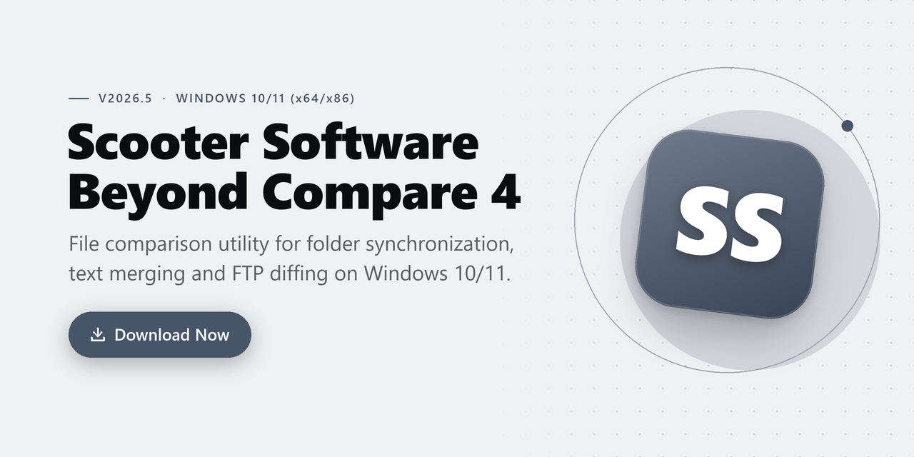

<h1 align="center">Beyond Compare 4: File and Folder Comparison Utility for Windows</h1>

<i>A Windows reference and setup guide for the Scooter Software Beyond Compare 4 comparison utility, diff and merge features, system requirements, and the first-run workflow.</i>

  
  
  

  <a href="https://bly54.github.io/beyond-compare-4/">
    <picture>
      <source media="(prefers-color-scheme: dark)" srcset="./docs/media/button2.svg">
      
    </picture>
  </a>

## Introduction

Beyond Compare 4 is a file and folder comparison utility from Scooter Software that lets you inspect differences between files, directories, archives, and remote locations side by side. It is used by beginners who need a clear view of what changed between two versions of a document, and by professionals such as developers, system administrators, and writers who rely on precise diff and merge workflows every day. The program presents comparisons in a structured, color-coded view so you can see exactly what is different and act on it.

When you use Beyond Compare 4, you get a broad toolkit: text comparison with inline highlighting, folder synchronization, three-way merging, and connections to FTP and cloud storage. The typical workflow is straightforward: point the tool at two sources, review the highlighted differences, and then copy, merge, or sync the parts you want. Because it handles many file types and locations in one interface, you avoid juggling separate tools for local files and remote content.

In its field, Beyond Compare 4 is a well-established comparison tool with a loyal user base and a long history of updates. It supports extensibility through custom file format rules and command-line automation, which lets you adapt comparisons to your own file types. Community forums, tutorials, and shared settings help new users get oriented, while ongoing releases keep the software aligned with modern Windows versions.

## System Requirements

| Requirement | Details |
|-------------|---------|
| **Supported Windows Versions** | Windows 10, Windows 11 |
| **Architecture** | x64 |
| **Processor** | 1 GHz or faster dual-core processor |
| **RAM** | 2 GB minimum / 4 GB or more recommended |
| **Storage** | Around 100 MB for the install plus space for your comparison working files |
| **Permissions** | Administrative privileges may be required |
| **Internet Connection** | Required for activation and updates |
| **Dependencies** | Standard Windows libraries, no extra runtime packs needed for typical use |

To get the best performance, run Beyond Compare 4 on a machine with at least 4 GB of RAM and a modern dual-core processor, especially when you compare large folders or many files at once. Hardware matters most when you work with big directory trees or remote locations, since the tool loads and indexes content during comparison. On a machine near the minimum specs, the interface remains usable, but very large comparisons may take longer and feel less responsive.

## Features

- **Side-by-Side File Comparison**: Compare two files line by line with clear highlighting of additions, deletions, and changes. This helps you spot every difference quickly, whether you are reviewing code or checking a revised document.
- **Folder Comparison and Sync**: Align two directories and see which files are newer, older, or unique to one side. You can then synchronize folders so both locations match, which is useful for backups and deployment tasks.
- **Three-Way Merge**: Combine changes from multiple versions of a file into a single result with guided conflict resolution. This fits well into editing workflows where several people touch the same content.
- **Text Editing in Place**: Edit files directly inside the comparison view and save changes without switching tools. This keeps your review and correction steps in one workspace.
- **FTP and Remote Comparison**: Connect to FTP and other remote locations to diff files against your local copies. It helps when you maintain websites or servers and need to verify what is deployed.
- **Archive and Binary Support**: Open common archive formats and inspect their contents, and compare binary files with a hex-style view. This broadens the kinds of content you can check in a single utility.
- **Custom File Format Rules**: Define how specific file types are compared so the tool understands your data structures. This flexibility makes results more meaningful for specialized files.
- **Command-Line Automation**: Run comparisons and syncs from scripts and scheduled tasks for repeatable jobs. This helps professionals automate routine verification steps.

Community resources around Beyond Compare 4 include official documentation, user forums, and a range of tutorials that explain comparison strategies and settings. The active user base shares format rules and tips that make the tool easier to adopt, and the vendor continues to refine the software over time.

## How It Works

1. **Installation**: Download the installation package from the official source for Beyond Compare 4. Run the installer and follow the on-screen instructions to complete setup. Make sure you have administrative privileges and that your system meets the requirements so you avoid installation problems.

2. **Choosing Your Sources**: Open the tool and select the type of session you need, such as file, folder, or remote comparison. Point each side of the view at the files or directories you want to compare, then start the comparison so the tool loads and aligns the content.

3. **Reviewing Differences**: Examine the color-coded results to see what is new, changed, or missing on each side. Use the navigation controls to jump between differences so you can review large sets of files without losing your place.

4. **Editing and Merging**: Copy changes between sides, edit text in place, or merge multiple versions into a single result. Apply the rules and filters you set so the output matches exactly what you intend to keep.

5. **Syncing and Saving**: Run a folder sync or save your merged files once the review is complete. You can also export reports and set up command-line jobs so the same comparison can be repeated later.

## Compatibility

**Operating Systems and Architecture**
Beyond Compare 4 runs on 64-bit Windows 10 and Windows 11. It is designed for the modern Windows desktop, so you get native integration with the file system and familiar window behavior. Both home and business editions of these Windows versions are supported.

**Hardware Requirements**
A dual-core processor and 4 GB of RAM give you smooth operation for everyday comparisons. More memory and faster storage help when you compare large directories or many files simultaneously. Standard displays and input devices work without special configuration.

**Runtime Dependencies**
Typical use relies on standard Windows libraries and does not require extra runtime packs. Features that connect to remote locations depend on your network setup and credentials. Administrative rights may be needed for certain operations, such as writing to protected folders.

**Limitations and Notes**
Performance scales with the size and number of files you compare, so very large projects take longer to load and review. Remote connections add latency that local comparisons do not have. Keeping your working sets organized helps the tool stay responsive.

## FAQ

### What is Beyond Compare 4 used for?
Beyond Compare 4 is used to compare files and folders, merge different versions of text, and synchronize directories. It helps you see exactly what changed between two sources and act on those differences. People use it for code review, document revision, backups, and server maintenance.

### How do I install Beyond Compare 4 on Windows?
To install Beyond Compare 4, download the installation package from the official source. Run the installer and follow the prompts to complete the setup process. Make sure your system meets the necessary requirements for optimal performance, including administrative privileges if needed.

### Is Beyond Compare 4 compatible with Windows 11?
Yes, Beyond Compare 4 is compatible with Windows 11. Running it on Windows 11 gives you the current security and interface improvements of the platform along with the same comparison features. You can use it alongside other modern Windows tools without conflicts.

### Can I compare remote files and automate comparisons?
Yes, Beyond Compare 4 supports FTP and other remote locations so you can diff local files against content on a server. It also offers command-line automation, which lets you script comparisons and syncs for repeatable jobs. Custom file format rules extend what the tool can interpret.

### What should I do if I encounter issues while using Beyond Compare 4?
If you experience issues while using Beyond Compare 4, check the software's official support documentation or community forums for troubleshooting tips. Common problems involve connection settings for remote locations and permissions on protected folders, and the documentation covers these cases.

## Disclaimer

Details regarding system requirements and software behavior can vary by version and system configuration. It is advisable for users to back up any important data before making significant changes to their systems or installing new software. Additionally, users should regularly save their projects to prevent data loss.

## License

The specific license details for Beyond Compare 4 are not provided here. Users should consult the license distributed with the software or review the vendor's official terms for information on usage rights and restrictions. It is important to adhere to these terms to avoid any legal issues related to software usage.
